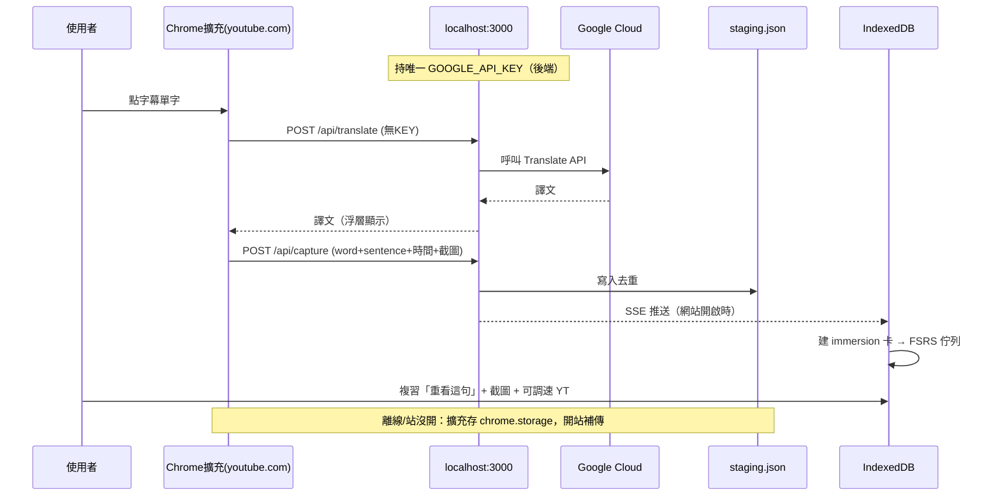

# 影片沉浸式學習模組（Chrome 擴充 + 本地站同步）

> 靈感來自 ZeroStudy：在 youtube.com 原地點字幕擷取單字（帶語境），同步回本機網站接進現有 FSRS 複習系統。
> 設計原則沿用 PLAN.md：離線優先、KEY 不暴露、開放資料、語言無關。

---

## 一、複用既有資產

| 既有元件 | 本模組用途 |
|---|---|
| `/api/translate`、`/api/dictionary`、`/api/tts` | 擴充直接呼叫拿譯文/詞性/發音 |
| `lib/srs/`（FSRS）、`lib/db.ts`（Dexie） | 擷取單字直接變卡片進複習佇列 |
| `lib/io/importExport.ts` | 生字表可攜（CSV/JSON/Anki） |
| `lib/stats/aggregate.ts` | 進度儀表板（沉浸學習占比） |

---

## 二、新增三塊

### 1. Chrome 擴充（content script on youtube.com）

- 監聽字幕 DOM（`.ytp-caption-segment`），把每段切成可點擊的 word span。
- 點單字 → `POST localhost:3000/api/translate` + `POST /api/dictionary`。
- 連同**整句原文 + videoId + 時間戳**一起 `POST /api/capture`（語境保存）。
- **Listening Mode**：CSS blur 模糊字幕，點擊/快捷鍵解除單句，逼聽力。
- 浮層小窗顯示當前擷取數、快速連跳本地站複習。
- 離線暫存（chrome.storage.local），開網站時補傳。

### 2. 本地站 capture 中繼（新增 `app/api/capture/*`）

- `POST /api/capture`：寫入 server-side staging（SQLite 一張表，單機夠用）。
- `GET /api/capture/stream`（SSE）：網站開啟時即時收新擷取，自動在 IndexedDB 建卡（`word+sentence` 去重）。
- 擷取時不必開網站；開站時自動合併 → 離線/在線皆可。

### 3. 卡片擴充欄位 + 新卡型

現有 `Card.example` 補成結構化語境：

```ts
context: {
  sentence: string,        // 整句原文
  videoId: string,         // 回跳 YouTube 該時間點
  startSec: number,        // 點擊當下字幕時間
  source: 'youtube',       // 來源標記（可擴充 netflix 等）
  capturedAt: number       // 擷取時間
}
```

- 新增 `cardType: 'immersion'`，區別手動建的卡，方便 /cards 篩選、/stats 看沉浸占比。
- 複習卡多一個「▶ 重看這句」按鈕 → 嵌入 YouTube iframe 跳到 `startSec`。

### 影片截圖（擷取當下影格）

點字幕時一併把當下影格存進 IndexedDB，複習時顯示在 iframe 上方，比純時間點更易回憶語境：

- **擴充** `captureScreenshot()`：`canvas.drawImage(<video>)` → JPEG dataURL（限寬 480px 控體積）；youtube.com 同源，canvas 不會被污染。
- **傳輸**：`/api/capture` body 多一欄 `screenshot`（base64 dataURL），進 staging JSON。
- **合併** `merge.ts`：`dataUrlToBlob` → 存 `imageBlobs` 表（Dexie v4 新增），`card.media.imageId` 指向它。
- **複習** `ReviewSession`：依 `media.imageId` 載入 Blob → objectURL 顯示圖；換卡自動 revoke。
- 離線優先：截圖跟其他擷取一起進離線暫存補傳；純本機 IndexedDB，不外傳。

### 語速控制（外語學習必備）

學外語常需慢速聽清楚、或加速複習。兩處皆可調，設定持久化：

- **TTS**（卡片發音／發音練習／翻譯播放）：`settings.playbackRate`，播放端套用 `audio.playbackRate` / `utterance.rate`。
  不改音檔、不分裂快取（同一份音檔可任意倍速）。`<TtsSpeedControl>` 分段鈕（0.5×–1.75×）置於首頁、複習、發音頁。
- **YouTube 重看**：`<YouTubePlayer>` 用 IFrame Player API `setPlaybackRate`（讀 `getAvailablePlaybackRates`），
  比純 iframe 多語速鈕；`settings.ytRate` 持久化。

### 雙語對照

`Card` 新增 `exampleTranslation`（例句中譯）。擷取/建卡時由本機站把整句（字幕語→母語）翻譯存入；複習反面兩行（西文例句＋中文譯文）。手動編卡有「🔍 譯例句」一鍵翻。

### 情境卡（scenario：聚合多句對話）

留住語感：不只存一句，可存連續對話。

- **擴充**：滾動緩衝近期字幕句（`recentLines`，上限 40）。`Q` 鍵或右上「🎬 存情境」浮按鈕 → 取最後 5 句（含各句時間）→ POST `scenario`。
- **schema**：`context.lines?: {text, startSec}[]`；`staging.scenario` 欄。
- **merge**：情境卡 `example` = 句以 ` / ` 聯接、整段中譯存 `exampleTranslation`、tag 加 `scenario`、去重以聯接文字比對。
- **複習**：`context.lines` 逐句顯示（帶 mm:ss）＋整段中譯；**知識庫**：`/library` 列出，帶「情境」標記。

### 知識庫頁（/library）

網站可獨立開，是個人知識庫：不必連 YouTube。

- **最近瀏覽影片**：擴充開 `/watch` 時 ping `/api/visit`（含 `document.title`），SPA 監聽 `yt-navigate-finish`；以 videoId 去重、累計次數。縮圖用 `img.youtube.com`、可點選篩選。
- **我的 highlight**：依 videoId 分組所有 immersion 卡（單字＋情境），雙語對照＋截圖＋`▶ mm:ss 重看` 連結。

### 定期提醒（FSRS 主動通知）

- `lib/notifications/`：進站檢查 due 卡數；>0 且當日未通知 → 頂部橫幅「今天有 N 張待複習」+ 瀏覽器 Notification（請求權限、點擊跳 `/cards/review`）。
- 每日最多一次（localStorage `lastNotified`），不打擾；離線可用（只讀 IndexedDB due）。

---

## 三、同步流向

```
youtube.com 點字幕 ──POST /api/capture──▶ 本地站 staging(SQLite)
                                                │ SSE
                                                ▼
                              網站開啟 ──▶ IndexedDB 建卡 ──▶ FSRS 複習佇列
```

---

## 四、與既有原則對齊

- **離線優先**：擴充 chrome.storage 暫存，網站開啟補傳；staging 也在本地。
- **KEY 不暴露**：擴充只打本地 API route，第三方 KEY 仍走後端代理。
- **開放資料**：capture 卡同樣 JSON 匯出。
- **語言無關**：capture 帶 `lang`，沿用使用者設定的 source/target。

---

## 四之一、架構圖（PlantUML + Mermaid）

> 重點：擴充**不持 KEY**，只打 `localhost:3000`；唯一的 Google KEY 只在後端 `.env.local`，永不下發。

### PlantUML

```plantuml
@startuml
skinparam rectangle { BackgroundColor #FFF }
skinparam ArrowFontColor #444

actor 使用者 as U
rectangle "Chrome 擴充\n(content script on youtube.com)" as EXT #E8F0FE
rectangle "本機站 localhost:3000\n(Next.js API routes)" as API #FFF7E6
database "Google Cloud\n(Translate + TTS)" as G #FCE8E6
database "staging\n(data/capture/staging.json)" as ST #F3E8FF
database "IndexedDB\n(Dexie)" as DB #E6F4EA
note right of API
  唯一一組 GOOGLE_API_KEY
  只在後端 .env.local
  擴充拿不到
end note

U --> EXT : 看影片、點字幕單字
EXT --> API : POST /api/translate\n(無 KEY)
API --> G : 用 GOOGLE_API_KEY 呼叫
G --> API : 譯文 / 音檔
API --> EXT : 譯文
EXT --> API : POST /api/capture\n(word+sentence+時間+截圖)
API --> ST : 寫入 staging (去重)

API --> DB : SSE /api/capture/stream\n(網站開啟時)
DB --> DB : 建 immersion 卡\n→ FSRS 複習佇列
U --> DB : 複習時「重看這句」\n+ 截圖 + 可調速 YT 播放器

note bottom of EXT
  離線／站沒開時：
  存 chrome.storage.local
  每 60s + 開站補傳
end note
@enduml
```

### Mermaid

```mermaid
flowchart LR
  U([使用者]) -->|看影片、點字幕單字| EXT["Chrome 擴充<br/>(youtube.com)"]
  EXT -->|POST /api/translate · /api/dictionary<br/>(不持 KEY)| API["本機站 localhost:3000<br/>Next.js API routes"]
  API -.->|"唯一一組 GOOGLE_API_KEY<br/>(後端 .env.local，擴充拿不到)"| G[("Google Cloud<br/>Translate + TTS")]
  G -.->|譯文 / 音檔| API
  API -->|譯文| EXT
  EXT -->|POST /api/capture<br/>word+sentence+時間+截圖| API
  API -->|寫入去重| ST[("staging.json<br/>本機檔案")]
  API -->|SSE /api/capture/stream<br/>網站開啟時| DB[("IndexedDB (Dexie)")]
  DB -->|建 immersion 卡<br/>→ FSRS 複習佇列| DB
  U -->|複習：重看這句<br/>截圖 + 可調速 YT 播放器| DB

  classDef ext fill:#E8F0FE,stroke:#1a73e8;
  classDef api fill:#FFF7E6,stroke:#f9a825;
  classDef g fill:#FCE8E6,stroke:#d93025;
  classDef store fill:#E6F4EA,stroke:#188038;
  class EXT ext;
  class API api;
  class G g;
  class ST,DB store;
```



---

## 五、實作階段

| 步驟 | 內容 | 狀態 |
|---|---|---|
| 1 | `context` 欄位 + `/api/capture` 中繼（站內可獨立測試） | ✅ 完成（schema + Dexie v3 + staging + SSE + merge + 頂部同步徽章） |
| 2 | Chrome 擴充：字幕解析 + 點擊擷取 + 離線暫存 | ✅ 完成（MV3 content script + popup 設定 + 離線暫存補傳） |
| 3 | Listening Mode + 「重看這句」按鈕 + /stats 沉浸占比 | ✅ 完成（擴充 Listening Mode / 複習卡 YouTube iframe 重看 / /stats immersion 占比 + byType 測試） |