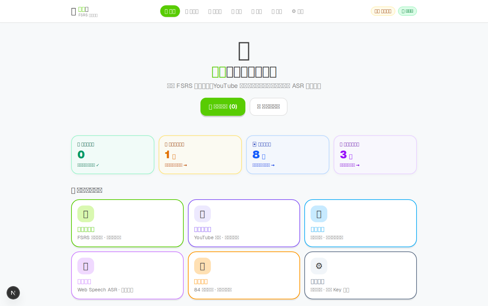
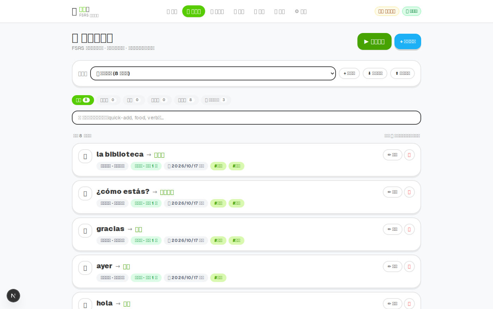
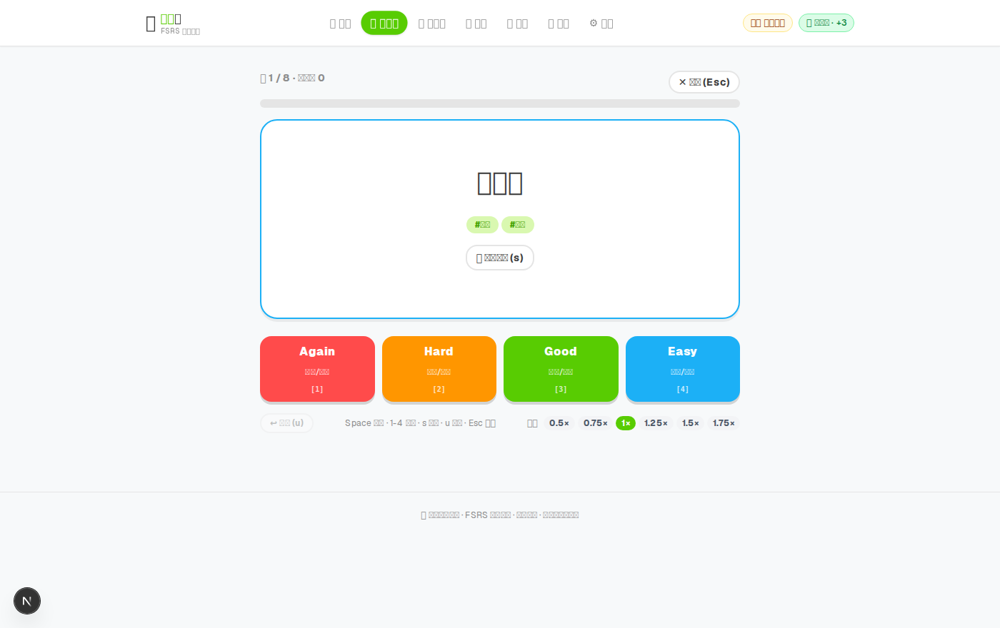
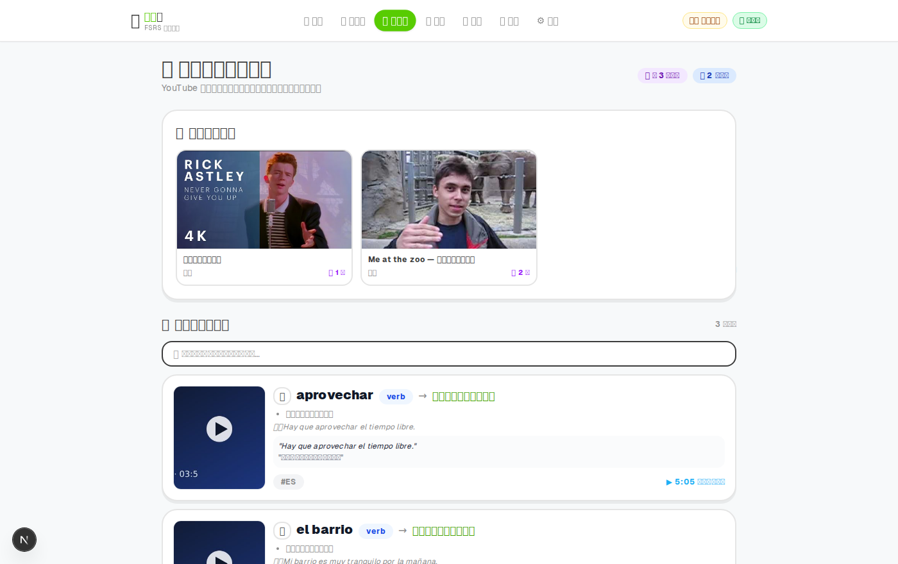

# 🦉 外語學習平台 (Language Learning Platform)

> 通用、語言無關、離線優先的現代化外語學習系統。  
> 結合 **FSRS-4.5 間隔複習**、**YouTube 沉浸式字幕擷取 Chrome 擴充**、**發音評測**、**個人學習計畫**與**記憶統計分析**。

[](https://github.com/Weichen5700/languagelearn/actions/workflows/ci.yml)


---

## 📸 畫面預覽 (Screenshots)

| 首頁 | 單字卡中心 |
|:---:|:---:|
|  |  |
| **FSRS 複習（翻面評分）** | **YouTube 影片知識庫** |
|  |  |

> 其餘畫面（學習計畫、發音評測、統計、設定）在 [`docs/screenshots/`](docs/screenshots/)。
> 需要重新產生時：先 `npm run dev`，另開終端機執行 `npm run shots`（Playwright 會即時建立示範資料後截圖）。

---

## 🌟 核心特色 (Key Features)

- **🧠 科學間隔複習 (FSRS SRS)**
  - 採用先進的 **FSRS v4.5**（Free Spaced Repetition Scheduler）演算法，比傳統 Anki SM-2 演算法減少約 30% 複習量，更精準預測遺忘曲線。
  - 支援全鍵盤快捷鍵（`Space` 翻面、`1/2/3/4` 評分）、雙語標籤提示（`Again / Hard / Good / Easy`）。
  - 卡片庫支援狀態分頁篩選（全部、待複習、新卡、學習中、已熟練、影片擷取）。

- **🎬 YouTube 沉浸式字幕擷取 (Chrome Extension)**
  - 瀏覽 YouTube 外語影片時，直接在字幕點擊生詞或整句。
  - 自動帶入影片當前影格截圖、時間戳記、原文例句、字典釋義與音標，一鍵同步回傳至本機字卡庫。
  - 支援 **Listening Mode**（字幕模糊模式鍛鍊聽力，滑鼠 hover 揭露）與時間軸側欄記錄。

- **📖 智慧字典整合與秒速造卡**
  - 輸入正面單字時自動查詢字典，呈現 IPA 國際音標、詞性分類、釋義清單與例句對照。
  - 點擊釋義候選詞即可**一鍵自動填入反面**，大幅降低手動製作單字卡的時間成本。

- **🎤 發音評測中心 (Pronunciation Practice)**
  - 整合 Web Speech ASR 語音辨識比對與 TTS 朗讀。
  - 支援隨機抽卡評測、即時麥克風波紋回饋、逐詞相似度比對與等級回饋評語。
  - 內建 0.5× ~ 1.75× 播放語速微調控制。

- **📅 個人學習計畫 (Study Plans)**
  - 依個人節奏量身打造學習目標與每日進度排程。
  - 支援多計畫管理、每日待辦任務清單與完成進度百分比追蹤。

- **📊 學習數據統計 (Stats & Heatmap)**
  - 提供 84 天學習熱力圖、記憶留存率分析、卡片狀態分佈與每日學習時長累積。
  - 內建 IndexedDB 資料庫一鍵備份匯出與匯入功能，資料完全掌控在自己手中。

- **🔒 隱私安全與離線優先 (Offline First & Privacy)**
  - 所有卡片、學習紀錄、設定皆儲存於本機瀏覽器 IndexedDB（Dexie.js），無網路也能流暢複習。
  - Google Cloud API Key 透過後端代理與本機 AES-256-GCM 加密保護，**金鑰永不暴露給前端**。

---

## 🏗️ 專案架構 (Architecture)

本專案採用 Monorepo 結構管理前端網站與瀏覽器擴充套件：

```text
外語學習嘗試/
├── apps/
│   ├── web/                     # Next.js 16 網站主應用 (App Router)
│   │   ├── app/                 # 頁面路由 (/cards, /library, /plans, /pronunciation, /stats, /settings)
│   │   │   └── api/             # 代理 API (translate, tts, dictionary, capture, keys)
│   │   ├── components/          # UI 元件 (AppShell, CardEditor, ReviewSession, TtsSpeedControl 等)
│   │   └── lib/                 # 核心邏輯 (FSRS 演算法, Dexie 資料庫, 統計聚合, 字典等)
│   └── extension/               # Chrome 擴充套件 (Manifest V3)
│       ├── manifest.json        # MV3 擴充套件設定
│       └── src/                 # Content Scripts (字幕監聽、側欄控制、擷取對話框)
├── data/
│   ├── languages/               # 語言設定定義檔 (es.yaml, en.yaml, zh.yaml 等)
│   └── .keys/                   # (本機加密金鑰目錄，已被 gitignore)
├── PLAN.md                      # 產品設計規劃文件
├── IMMERSION.md                 # 沉浸式擷取模組技術規格
└── package.json                 # 根目錄 Scripts 封裝
```

---

## 🚀 快速開始 (Getting Started)

### 1. 環境需求
- Node.js **20.9+**（Next.js 16 需求；建議 22 LTS）
- npm / yarn / pnpm

### 2. 安裝相依套件與啟動網站
```bash
# 複製專案庫
git clone https://github.com/Weichen5700/languagelearn.git
cd languagelearn

# 安裝 web 套件
npm run install:web

# 啟動開發伺服器
npm run dev
```
啟動後於瀏覽器造訪：`http://localhost:3000`

---

## 🧩 載入 Chrome 擴充套件 (沉浸式學習)

1. 開啟 Google Chrome，於網址列輸入 `chrome://extensions/`。
2. 開啟右上角的**「開發人員模式」**。
3. 點選左上角**「載入未打包項目」**，選取專案目錄下的 `apps/extension` 資料夾。
4. 點選瀏覽器擴充工具列的圖示，確認顯示為 **ON**。
5. 前往 YouTube 開啟任一附有外語字幕的影片，字幕將變為可互動式點擊，點擊生詞即可體驗無縫截圖擷取與即時查詞！

---

## 🔑 API 金鑰配置 (可選)

本系統採**無 Key 降級支援**：未設定 API Key 時，系統會自動使用免費公共端點與瀏覽器原生語音進行翻譯與朗讀。

若需最高品質的 Google Cloud Translation 與 Neural TTS，可透過以下兩種方式配置：
1. **方式一（推薦，介面管理）**：在網站前往 **「系統設定」(`/settings`)**，在 API Key 區塊填入 `GOOGLE_API_KEY`，系統會以 AES-256-GCM 本機加密儲存。
2. **方式二（環境變數）**：
   在 `apps/web/` 下建立 `.env.local`：
   ```bash
   cp apps/web/.env.local.example apps/web/.env.local
   # 編輯 .env.local 並填入：
   # GOOGLE_API_KEY=你的金鑰
   ```

---

## 🌐 部署與分享 (Deploy)

### 情境 A：自架 / VPS（功能最完整，建議）
```bash
npm run install:web
npm run build
cp apps/web/.env.local.example apps/web/.env.local   # 選用：填入 GOOGLE_API_KEY
npm run start                                        # http://localhost:3000
```
- API Key 可在 `/settings` 貼入（AES-256-GCM 加密存於 `data/.keys/`），或用環境變數
- 擷取暫存寫入 `data/capture/`，可用 `CAPTURE_STORE_DIR` 指向 Docker volume 等持久位置

### 情境 B：Vercel（最快取得線上 demo）
1. Vercel → **Add New Project** → 選擇此 repo
2. **Root Directory 設為 `apps/web`**（monorepo 必要）
3. Environment Variables 加入 `GOOGLE_API_KEY`（選用；無 Key 會降級免費服務）
4. Deploy

> ⚠️ serverless 檔案系統唯讀、且每次冷啟動都是新容器，因此：
> - `/settings` 的 **Key 託管無法保存**（`/api/keys` 會回 `409` 並在畫面顯示指引）→ 請改用環境變數，清單會標示來源為 `env`
> - 擷取暫存僅存在單一實例的記憶體（API 回傳 `persistent: false`），重新部署即清空

### 讓 Chrome 擴充指向部署站
1. 擴充設定頁把「本機網址」改成部署網址（例如 `https://your-app.vercel.app`）
2. `apps/extension/manifest.json` 的 `host_permissions` 加入該網域後重新載入擴充：
   ```json
   "host_permissions": [
     "http://localhost/*",
     "http://127.0.0.1/*",
     "https://your-app.vercel.app/*"
   ]
   ```
3. API 已開 CORS（`Access-Control-Allow-Origin: *`），部署站可直接被擴充呼叫

---

## 🧪 測試與驗證 (Scripts)

在根目錄可直接使用以下指令：

```bash
# 啟動本機開發伺服器
npm run dev

# 執行全數單元測試（Vitest：12 檔 / 96 項 — FSRS 演算法、複習佇列、擷取合併、統計聚合、本機 Store、唯讀 FS 後備等）
npm test

# ESLint 靜態檢查（目前 0 error / 0 warning）
npm run lint

# 執行 TypeScript 靜態型別檢查
npm run check

# 建置生產環境版本 (Next.js Build)
npm run build

# 執行 Playwright 端對端 E2E 測試（首次需先安裝瀏覽器）
npx playwright install --with-deps chromium   # 於 apps/web 目錄執行
npm run e2e

# 重新產生 README 截圖（需先啟動 dev server；於 apps/web 目錄執行）
npm run shots

# 由 icons/icon.svg 重新產生 Chrome 擴充圖示（於 apps/web 目錄執行）
npm run icons
```

CI 由 GitHub Actions 執行（`.github/workflows/ci.yml`）：lint → typecheck → 單元測試 → build，
另有一個 Playwright Chromium 的 E2E job。

---

## 📌 專案狀態 (Status)

| 項目 | 狀態 |
|---|---|
| 功能（PLAN Phase 0–5） | ✅ 全部完成 |
| 單元測試 | ✅ 96 項全通過（Vitest） |
| 型別檢查 | ✅ `tsc --noEmit` 無錯誤 |
| ESLint | ✅ 0 error / 0 warning |
| 生產建置 | ✅ `next build` 18/18 頁面 |
| CI | ✅ GitHub Actions（lint / typecheck / test / build / e2e） |
| E2E | ⚠️ 本機需先安裝 Chromium（CI 會自動安裝） |
| 部署 | ✅ 自架（`build` + `start`）；Vercel 見「部署與分享」章節 |
| 擴充發佈 | ✅ 圖示（16/32/48/128）已備，可打包上架 |
| 雲端同步與帳號 | ⛔ 未實作（規劃中，見 `PLAN.md` 第十節） |

---

## 📄 授權協議 (License)

**保留所有權利（All rights reserved）** — 本專案僅供個人學習、研究與非商業性參考使用，
未經著作權人書面同意，不得複製、修改、散布或再授權。完整條文見 [`LICENSE`](./LICENSE)。

本專案所使用之第三方套件（Next.js、React、Dexie、Zod 等）依其各自授權條款釋出，不在本授權範圍內。
